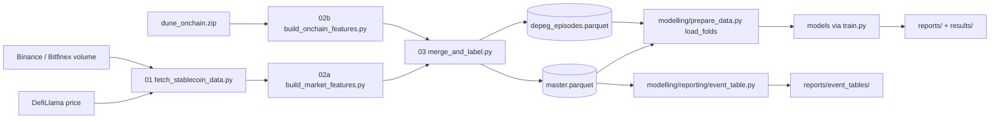

# Stablecoin Depeg Early-Warning — DSE4101 Topic 2 · Group 1

**Can market information available at time *t* predict whether a fiat-backed
stablecoin will depeg within the next *h* ∈ {1, 6, 24} hours — and does adding
on-chain flow data improve the early warning beyond market data alone?**

This is the team repository for the NUS DSE4101 capstone project (Digital
Currencies, Group 1). We build an **episode-level alarm system** for six
fiat-backed stablecoins (USDT, USDC, BUSD, DAI, TUSD, PAX; Sep 2018 – Dec 2025)
under an operational constraint: **at most 1 false alarm per coin-month on
average (~72 per year)**. The centre of the analysis is the **market-only
(Tier 1) vs market+on-chain (Tier 2)** comparison at h = 6 and h = 24.

> **Status (30 Oct 2026):** final deck in Canva. All deck numbers live in
> `reports/` and are documented slide-by-slide in
> [`plans/final_deck_changes.md`](plans/final_deck_changes.md) (per-slide copy,
> verified numbers, reorder). Prof-Huang feedback → changes mapping in
> [`plans/prof_changes_summary.md`](plans/prof_changes_summary.md).

---

## Corrected XGBoost/SHAP protocol (isolated repair)

### Corrected constant-prior and persistence benchmarks

These benchmarks must reuse corrected calendar features, merged-start labels,
completed-bar clocks, causal eligibility and chronological splits, not the
legacy benchmark tables. Run from the isolated worktree into an unused directory:

```powershell
python -m unittest modelling.checks.test_corrected_baselines modelling.checks.test_xgb_repair -v
python -m modelling.corrected_baselines --out-dir .\BASELINES-NEW-RUN
python -m modelling.verify_baselines --run-dir .\BASELINES-NEW-RUN --reference ..\CORRECTED-XGB-SHAP-RUN-V3
```

The driver evaluates h1/h6/h24 over 2021-2025 on own-sample market, matched
market and market+on-chain eligibility. Constant prior is fitted on each
configuration's **inner_train labels only**, never validation/test labels or
the full outer training partition. Within a fold all scores tie, so AP equals
that fold's evaluation prevalence. Different yearly training priors can rank
folds differently: **pooled AP need not equal pooled positive prevalence**,
and neither a universal AP floor nor zero alarms should be assumed.

Persistence uses `min(max(1-price, 0), 0.01)` at completed-bar close. It has
no on-chain inputs, but its evaluation population still depends on eligibility.
Matched market and market+on-chain baseline outputs should be identical.
Both baselines use the exact validation-candidate policy, including the
constant prior's finite all-row cutoff and infinity. A validation budget does
not guarantee test-period cost.

The independent verifier reloads predictions, reconstructs tie-aware pooled AP,
base rate, greedy inclusive-cooldown alarms, targetable/caught episodes, median
lead and observed partial coin-month exposure. A separate full-scan oracle
checks **every validation cutoff**. Saved run IDs, source/input hashes, sample
partitions, threshold candidates and compatibility checks identify the evidence.
Only completed, verified, protocol-compatible references enter model comparisons.
Use `--check-only` to repeat verification on an already verified run without
writing or replacing its evidence.

The historical `reports/`, `results/`, `train.py`, and all LR/RF outputs are
**legacy experiments**, not corrected evidence. The dedicated corrected driver
does not overwrite their datasets or artifacts:

```powershell
python -m unittest modelling.checks.test_xgb_repair -v
python -m modelling.corrected_xgb --out-dir .\corrected-results-NEW-RUN
python -m modelling.verify_corrected_run --run-dir .\corrected-results-NEW-RUN
```

Run from this worktree's root. The output directory must not exist. This executes
h6/h24 market-original, market-matched and market-plus-on-chain folds (2021–2025),
and T1/T2 SHAP; it never fits LR/RF. XGB fits exactly 300 rounds, depth 3,
learning rate .05, training-only neg/pos class weight, seed 42, at most 4 threads.
Each scoring fit uses only `inner_train`; its disjoint `inner_val` selects the
threshold, and the same saved fit scores test. No test outcome selects settings.

Every distinct validation score and +infinity is evaluated exactly. The objective
is highest validation **episode recall** within grouped false alarms / observed
coin-months ≤1; ties prefer fewer false alarms, then the higher threshold.
Grouped alarm cost is non-monotone because the inclusive h-hour cooldown can
suppress a later false alarm. A Fenwick active-row index accelerates exhaustive
evaluation without dropping candidates. Observed partial coin-months count as
months; this is not an exposure-normalized guarantee, nor a test-period budget cap.

Source `hour` denotes the bar start. Corrected operational `hour` is its close
(`bar_start+1h`), after that bar's price/volume/on-chain aggregates are available.
Episode onset is the **close of the first below-band bar**, retrospectively
confirmed by a second consecutive below-band bar. Targets and alarm truth both
use new merged starts in `(origin_close, origin_close+h]`; lead is onset close
minus origin close, not time before the underlying within-bar physical move or
the second-bar confirmation. Negatives require all h+1 future prices (confirmation
lookahead) observed; label availability filters offline scoring only, never live
risk eligibility. Risk eligibility uses current above-band price and a >24h
recovery clock since the recovery anchor of the latest online-confirmed dip.
It never uses hindsight-known final episode end. Short dips do not reset recovery.
Calendar-grid lags preserve missing endpoints; volatility uses complete windows.
Unknown venue history excludes volume-change origins, never becomes fabricated
zero history. The committed raw source's earlier filling, gaps and publication
latencies cannot be recovered: this is an idealized end-of-bar backtest, not
certification of real-time data availability.

Each immutable run records source/code hashes, versions, model/preprocessing,
partition keys, feature order, actual rounds, validation/test predictions and
reload checks (absolute tolerance 1e-8). SHAP loads those exact saved fits and test
features: raw-margin tree-path-dependent TreeExplainer, background represented by
inner-train tree cover counts, all OOS rows explained. Additivity must hold within
1e-4 log-odds units; group shares must independently sum within 1e-10. Beeswarms
use a seed-42 sample of at most 15,000 explained rows; magnitude tables use all rows.
These are model attributions, not causal benefit or removal of coin identity.
Matched uncertainty uses paired coin-month AP bootstrap and 24h-chained onset
event-cluster recall bootstrap, conditional on the fitted models and thresholds.
h1 and optional sensitivity/smoothing/OR claims are not validated by this run.

## Table of contents

1. [Research question & design](#1-research-question--design)
2. [Repository map](#2-repository-map)
3. [Data pipeline](#3-data-pipeline)
4. [Evaluation protocol](#4-evaluation-protocol)
5. [Models](#5-models)
6. [Results](#6-results)
7. [Quick start](#7-quick-start)
8. [Hard rules](#8-hard-rules)
9. [Local-driver pattern](#9-local-driver-pattern)
10. [Known quirks & gotchas](#10-known-quirks--gotchas)
11. [Git workflow](#11-git-workflow)

---

## 1. Research question & design

| Element | Choice |
|---|---|
| Coins | USDT, USDC, BUSD, DAI, TUSD, PAX (fiat-backed majors only) |
| Period | Sep 2018 – Dec 2025, hourly (345,367 coin-hours) |
| Depeg definition | price < $0.99 for ≥ 2 consecutive hours; dips within 24h of recovery merge into one episode |
| Episodes / events | **79 episodes → 56 events** (episodes on different coins starting within 48h of an event's first onset are one event) |
| Information sets | **Tier 1** = 9 market features · **Tier 2** = Tier 1 + 12 on-chain log1p-diff features (21 total) |
| Horizons | h = 1 (near-detection), 6, 24 hours |
| Labels | onset-only: `label_h{h} = 1` if a new episode starts in (t, t+h]; in-episode + 24h recovery hours excluded (at-risk sample) |
| Objective | early-warning alarm: catch every episode, tolerate false alarms |
| Budget | **1 false alarm per coin-month on average (≈72/yr)** — fixed before seeing results |
| Headline metric | episode recall @ ≤1 FA/coin-month + median lead time; PR-AUC (with base rate) secondary |
| Out-of-sample | expanding window, test years 2021–2025 → **46 episodes / 30 events** in test years, of which **34 are targetable at h=24** (33 at h=6, 32 at h=1) |

---

## 2. Repository map

```
├── data/
│   ├── raw/dune_onchain.zip          # Dune on-chain exports (committed source; chain scope: see §3)
│   └── processed/
│       ├── master.parquet             # CANONICAL dataset: 345,367 × 44 (committed)
│       └── depeg_episodes.parquet     # 79-episode manifest (committed)
├── data_processing/                   # FROZEN pipeline (01 fetch, 02a market, 02b on-chain, 03 merge+label, splits, config)
├── modelling/                         # ACTIVE modelling workspace
│   ├── prepare_data.py                # THE data contract: load_folds(horizon, tier)
│   ├── train.py                       # orchestrator (folds, tuning, pooled OOS eval)
│   ├── evaluate.py                    # pooled metrics, alarm sweeps, thresholds
│   ├── alarm_events.py                # cooldown-grouped alarm events + lead hours
│   ├── alarm_report.py                # operating-point table (recall@budget, rate@recall)
│   ├── compare_runs.py                # pooled PR-AUC/ROC/Brier/pos_rate table
│   ├── combine_alarms.py              # OR-union robustness test
│   ├── rolling_threshold.py           # HELPER LIBRARY (no CLI): _choose_threshold etc.
│   ├── robustness_check.py            # Vienna's robustness driver
│   ├── models/                        # BaseModel contract + baseline, persistence, logreg, random_forest, xgboost
│   ├── reporting/event_table.py       # episode → event grouping + figures
│   ├── feature_importance/shap_analysis.py  # SHAP rankings, beeswarms, group shares
│   └── checks/test_tier2_features.py  # leakage probe
├── plans/                             # LOCAL DRIVERS + slide docs (see §9)
├── reports/                           # COMMITTED results (tables + figures)
│   ├── modelling_comparison.csv       # PR-AUC + base rates, all fixed-config runs
│   ├── ex_post_comparison.csv         # real-time vs ex-post: recall, FA/cm, median lead
│   ├── local_budget_curve.csv         # recall vs FA/coin-month budget sweep (0.5–8)
│   ├── coverage_table.csv             # per-coin Tier-2 coverage
│   ├── event_tables/                  # events.csv, episodes.csv, types_*.csv, caught_by_type.csv, figures/
│   ├── rolling_thresholds/            # per-year real-time threshold CSVs (XGB)
│   └── figures/                       # SHAP + per-year caught figures (fixed-config)
├── results/                           # GITIGNORED scratch (predictions, models, logs)
└── archive/                           # legacy scripts/figures/old reports (dead weight, kept for history)
```

---

## 3. Data pipeline



| Step | Script | Reads | Writes |
|---|---|---|---|
| 01 | `fetch_stablecoin_data.py` | Internet (DefiLlama, Binance, Bitfinex) | `data/processed/hourly_stablecoin.parquet` |
| 02a | `build_market_features.py` | step 01 output | market features parquet |
| 02b | `build_onchain_features.py` | `dune_onchain.zip` | on-chain features parquet (+ unzipped CSVs in `data/raw/`) |
| **03** | **`merge_and_label.py`** | 01 + 02a + 02b | **`master.parquet`** + **`depeg_episodes.parquet`** |

**The pipeline is FROZEN.** Never re-run step 01 (1,200+ HTTP requests). If
`master.parquet` is missing the `*_logdiff_*` columns, run
`python data_processing/build_onchain_features.py --update-master`.

### Master dataset (`data/processed/master.parquet`)

One row per coin-hour. **345,367 rows × 44 columns** (32 base + 12 on-chain
change features). Committed to git by team convention despite the 50 MB
recommendation.

| Coin | Start | End | Coverage (all Tier-2 fields present) |
|---|---|---|---|
| USDT | 2018-09-01 | 2025-12-31 | 96.5% |
| USDC | 2018-10-05 | 2025-12-31 | 97.8% |
| BUSD | 2019-09-21 | 2024-02-29 | 93.3% |
| DAI  | 2019-11-18 | 2025-12-31 | 99.9% |
| TUSD | 2019-01-04 | 2025-12-31 | 93.0% |
| PAX  | 2018-09-26 | 2025-12-31 | 91.1% |

(Source: `reports/coverage_table.csv` — % of hours in the coin's observed span
where exchange volume + all four on-chain fields are present.)

> **Chain scope:** the Dune CSVs carry no chain column, but the data is
> confirmed to cover **Ethereum mainnet only (ERC-20 transfers)** based on contract
> inception dates (e.g. DAI Nov 2019, USDT Jan 2018), NYDFS BUSD deprecation, and
> typical hourly transaction volumes (~5.4k/h for USDT vs >100k/h on Tron). State
> this on the P4 data slide.

---

## 4. Evaluation protocol

Expanding-window CV, test years 2021–2025, with a 24h purge and 24h embargo at
every boundary; episodes straddling a boundary are dropped. Thresholds are
**never chosen on test rows** in the real-time protocol.

```mermaid
flowchart TB
    subgraph fold["One expanding-window fold for test year Y"]
        P[practice model on years before Y-1] --> V[score year Y-1]
        V --> T1["real-time: pick lowest threshold with <= 1 FA/coin-month on Y-1"]
        F[final model on years before Y] --> YR[score year Y]
        T1 --> A1["apply threshold to Y: recall, FA/cm, median lead"]
        YR --> T2["ex post: pick lowest threshold with <= 1 FA/coin-month on Y itself"]
        T2 --> A2["apply to Y: recall, FA/cm, median lead<br/>USES TEST-YEAR INFO - not deployable live"]
    end
    A1 --> P1[(pool across 2021-2025)]
    A2 --> P2[(pool across 2021-2025)]
```



- **Real-time** (how the system would actually perform): threshold set on the
  prior year, applied unchanged to the test year. The realised FA/cm can drift
  from the 1.0 budget (2021 XGB T2 = 3.11, 2022 = 0.30) — the gap is itself a
  reported result.
- **Ex post** (the fair model comparison): threshold set on the test year's own
  scores at the same budget. Explicitly labelled as not implementable live.
- **Alarm definition:** `score ≥ threshold` starts an alarm; repeat flags for
  the same coin within h hours are one alarm; an alarm is **true** if a new
  episode starts in (t, t+h], otherwise it is a **false alarm**. Budget counts
  are **averages across observed coin-months**, so 60 alarms across 60
  coin-months is within budget even if one month has two and another none.
- Both modes report: episode recall (n/34), realised FA/cm vs budget, and
  **median lead time** over true alarms.

---

## 5. Models

All models share the `modelling/models/base.py::BaseModel` contract and the
same five expanding-window folds (`train.py`). **Final protocol = fixed
settings, no tuning grids** (per prof's guidance):

| Model | Fixed configuration | NaN handling |
|---|---|---|
| Constant prior (floor) | always predicts the historical base rate | — |
| Peg-stress persistence | alarms when the peg is stressed now (`peg_deviation`) | — |
| Logistic (L1) | `C=0.001, penalty="l1", class_weight="balanced", winsor 0.01`, `abs_peg_dev` + `peg_deviation × realised_vol_6h` added in-model | train-only median imputation |
| Random Forest | `n_estimators=500, max_depth=8, min_samples_leaf=50, max_features="sqrt", class_weight="balanced_subsample", random_state=42` | train-only median imputation |
| XGBoost | `max_depth=3, learning_rate=0.05, n_estimators=300, min_child_weight=1, scale_pos_weight="auto", tree_method="hist", random_state=42` | NaN-native |

---

## 6. Results

All numbers verified 30 Oct 2026; sources listed under each table.

### Real-time main table, h = 24 (threshold set on the prior year; budget 1 FA/coin-month)

| Model | PR-AUC (base rate) | Recall | Realised FA/cm | Median lead |
|---|---|---|---|---|
| Constant prior | 0.0063 / 0.0064 (0.43/0.46%) | 0 / 0 | 0.00 / 0.00 | — |
| Persistence | 0.0479 / 0.0338 | 9/34 / 9/34 | 0.94 / 0.87 | 7h / 10h |
| Logistic | 0.0312 / 0.0300 | **13/34** / 11/34 | 1.03 / 0.93 | 10h / 7h |
| Random Forest | **0.0685 / 0.0454** | 7/34 / 10/34 | 0.82 / 0.79 | 8h / 8h |
| XGBoost | 0.0480 / 0.0412 | 13/34 / **15/34** | 1.10 / 1.12 | 14h / **9h** |

Columns are T1 / T2. h = 6 block and full per-year detail:
`reports/ex_post_comparison.csv`, `_per_year.csv`. PR-AUC/base rates:
`reports/modelling_comparison.csv` (base rates h6: 0.13%/0.14%).

### Ex-post comparison, h = 24 (threshold set on the test year — fair, not deployable)

| Model | Recall T1 / T2 | Median lead T1 / T2 |
|---|---|---|
| Persistence | 6/34 / 6/34 | 13h / 20h |
| Logistic | 6/34 / 6/34 | 16h / 16h |
| Random Forest | 8/34 / **9/34** | 8h / 8h |
| XGBoost | 4/34 / 5/34 | 16.5h / 10h |

**Reading:** the real-time XGB lead partly reflects a well-fitting prior-year
threshold. Ex post the models converge and RF catches the most; the on-chain
edge shrinks to ≈1 episode at h24 (5 vs 4), concentrated in staggered/sustained
(SVB-type) events (`reports/event_tables/caught_by_type.csv`). Figure:
`reports/ex_post_vs_real_time_h24.png`.

### Other headline numbers

- **h = 1 (near-detection):** XGB T1 2/32, T2 3/32, lead ≈1h — the useful signal starts at h=6.
- **Median lead (XGB T2, h24):** 9.0h (p25 4.0, p75 15.0).
- **Event types** (56 events / 79 episodes): market-wide simultaneous 7/21 ·
  staggered 7/16 · sustained single-coin 9/9 · short single-coin 12/12 ·
  brief wobble 21/21 (`reports/event_tables/types_summary.csv`).
- **SHAP (fixed XGB T2, h24):** on-chain share of \|SHAP\| = **20.7%** (17.7% at
  h6); top features `realised_vol_24h` 21.8%, `realised_vol_6h` 13.3%,
  `peg_deviation` 12.1% (`reports/figures/group_share_xgboost_t2_h24_fixed.csv`).
- **Robustness:** at the tighter **0.5 FA/cm budget the leader flips** (RF T2
  6/34 vs XGB T2 3/34; T1 ≥ T2) — the on-chain edge appears at budgets ≥1 FA/cm.
  OR-union at 1% hourly budget: 0.647 vs 0.500 best single; gain 0 at 2%
  (`reports/combination_results.csv`, `reports/local_budget_curve.csv`).
- **2022:** every model is 0/9 on the January 2022 market-wide wobble (2/9 even
  at 8× budget). May-2022 Terra dips are single-hour wicks outside the ≥2h
  episode definition.

---

## 7. Quick start

```bash
pip install -r requirements.txt

# Data sanity check (must reproduce 79 episodes; 32/33/34 targetable at h1/6/24)
python modelling/prepare_data.py

# Train a model (fixed-config example)
python modelling/train.py --model xgboost --horizon 24 --tier 2 \
    --tag xgb_d3_lr005_300 \
    --model-params '{"max_depth":3,"learning_rate":0.05,"n_estimators":300}'

# Refresh the pooled metrics table (PR-AUC, ROC-AUC, base rates)
python modelling/compare_runs.py --save reports/modelling_comparison.csv

# Local drivers (the group's analysis pattern — see §9)
python plans/ex_post_comparison.py      # real-time vs ex-post + median lead
python plans/local_curve.py             # recall vs FA/coin-month budget sweep
python plans/event_types.py             # event types + caught/missed by type
python plans/coverage_table.py          # per-coin Tier-2 coverage

# Reporting
python modelling/reporting/event_table.py                # episode -> event tables + figures
python modelling/feature_importance/shap_analysis.py --model xgboost --horizon 24 --tier 2
python modelling/checks/test_tier2_features.py           # leakage probe
```

---

## 8. Hard rules

| # | Rule |
|---|---|
| R1 | `data_processing/` is **FROZEN**. |
| R2 | **NEVER run `fetch_stablecoin_data.py`** (1,200+ HTTP requests). `master.parquet` is committed. |
| R3 | All modelling data goes through `modelling/prepare_data.py → load_folds()`. Never read raw CSVs/parquets in model code. |
| R4 | Raw on-chain **levels** are NOT features (they identify the coin). Use the `*_logdiff_*` columns. |
| R5 | One feature branch per task, PR into `main`, Shao Gjin reviews. |
| R6 | `results/` is gitignored scratch. Final tables/figures go in `reports/`. |

---

## 9. Local-driver pattern

The group runs **one-off analyses as standalone scripts in `plans/`** that
import helpers from the modelling modules — committed modelling scripts are
**not modified per-analysis and carry no analysis CLI flags**
(`rolling_threshold.py` is a pure helper library; its old CLI was removed on
30 Oct 2026).

```python
# plans/your_analysis.py  — the pattern
import sys
from pathlib import Path
REPO = Path(__file__).resolve().parents[1]
sys.path.insert(0, str(REPO)); sys.path.insert(0, str(REPO / "data_processing"))
from modelling.rolling_threshold import _choose_threshold, _validation_and_test_scores  # etc.
MODELS = [("xgboost", "xgb_d3_lr005_300"), ...]   # hardcoded fixed-config list
# loop folds -> fit once -> compute -> write CSV under reports/
```

Existing drivers: `plans/ex_post_comparison.py`, `plans/local_curve.py`,
`plans/event_types.py`, `plans/coverage_table.py`.

---

## 10. Known quirks & gotchas

1. **Brier caution:** `scale_pos_weight` / `class_weight` inflate probabilities.
   Compare models on PR-AUC / ROC-AUC / recall curves, **not Brier**, unless
   probabilities are recalibrated.
2. **Tier 1 vs Tier 2 samples differ** (T2 ⊂ T1: on-chain eligibility), so the
   comparison mixes a feature effect with a sample-composition effect — flagged
   (†) on the deck; Javier's matched-sample rerun lives on the `logreg-model`
   branch (not yet merged).
3. **2024/2025 test years hold ~3 episodes between them** — always evaluate on
   pooled OOS, never per year.
4. `venue_switch` appears twice (`venue_switch_x`/`_y`); `prepare_data.py`
   ignores both.
5. **2022 miss = the January 2022 wobble**, not Terra. Terra-era dips are
   single-hour wicks excluded by the ≥2h episode rule.
6. Thresholds are per-fold — live deployment needs rolling recalibration; the
   ex-post comparison is explicitly **not** a deployable scheme.
7. Legacy experiments (alarm smoothing = negative result; OR-union ≈ 0 gain;
   cascade) are archived in `archive/legacy_modelling/` and summarised in
   `agent.md` §7.

---

## 11. Git workflow

- Remote: `origin` = personal fork · `upstream` = `shaogjintan/stablecoin-depegging-analysis`.
- **Create feature branches from `upstream/main`**, never from a stale local `main`.
- Push feature branches to upstream and open PRs there.
- Current branches (30 Oct 2026): `results/fixed-config-local` (fixed-config
  results, 1 commit ahead of main) and `cleanup/dead-weight-final-deck`
  (dead-weight archive + local drivers + verified results; 5 commits ahead of
  main, pushed to origin). **Both still need PRs into `upstream/main`.**
